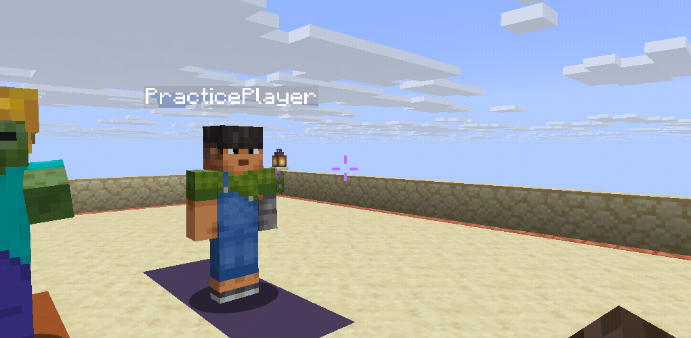
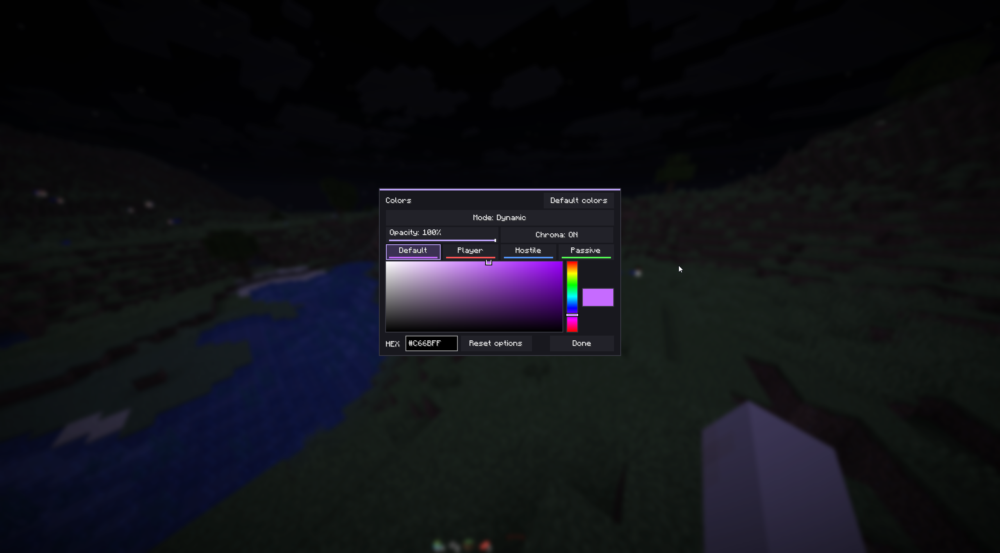
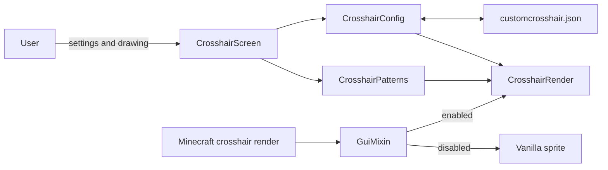

<div align="center">
<h1>Custom Crosshair</h1>
<hr>
<b>3 ways to shape a crosshair: simple geometry, presets, pixel drawings.</b>
<p>


</p>
<p>
<a href="https://github.com/hhhhhffd/CustomCrosshair/releases"></a>
<a href="https://github.com/hhhhhffd/CustomCrosshair/releases"></a>
<a href="LICENSE"></a>
</p>
<p><a href="https://github.com/hhhhhffd/CustomCrosshair/releases">Download</a> · <a href="#architecture">Architecture</a> · <a href="#build">Build</a></p>
</div>

## Overview

Custom Crosshair is a client-side Fabric mod for Minecraft Java 1.21.11. It replaces the base crosshair sprite with configurable geometry, a preset, or a pixel drawing while keeping the vanilla attack cooldown indicator. It is an independent implementation inspired by the public [Lunar crosshair guide](https://www.lunarclient.com/news/how-to-make-a-custom-crosshair-on-lunar-client), not a copy of Lunar Client code or assets.




## Technical Stack

| Area | Technology | Version / role |
| --- | --- | --- |
| Core | Minecraft Java | 1.21.11 |
| Core | Fabric Loader / Fabric API | 0.20.1 / 0.141.6+1.21.11 in the build |
| Core | Java | 21 |
| Build | Fabric Loom | 1.13.6, Gradle wrapper |
| Integration | Mod Menu | 17.0.1 compile-only; optional settings UI |

## Architecture



- The GUI mixin redirects only the base sprite, leaving Minecraft's spectator gates and attack indicator in place.
- `CrosshairPatterns` handles shapes and LCCH codes separately from the UI and renderer; the standalone format test exercises this logic without Fabric.
- Configuration is saved to a temporary file and moved into place, with a fallback when atomic moves are unavailable. Older color keys are accepted on load.

## Project Structure

```text
.
├── build.gradle       # Fabric Loom build and dependencies
├── gradle.properties  # Minecraft and dependency versions
├── src/
│   ├── client/        # Rendering, settings, patterns and translations
│   └── main/          # Fabric metadata and mixin configuration
├── tests/
│   ├── CrosshairPatternsTest.java  # Standalone format tests
│   └── README.md      # Test instructions
└── docs/media/        # Previews
```

## Install and Usage

1. Install Minecraft Java 1.21.11 with Fabric Loader 0.18.4 or newer and Fabric API 0.141.6 or newer. Download the mod JAR from [Releases](https://github.com/hhhhhffd/CustomCrosshair/releases) and put it and Fabric API in the client `mods` folder.
2. Install Mod Menu 17.0.0 or newer to access the settings screen; the build uses 17.0.1. Open **Mods → Custom Crosshair → Settings**. No server installation is needed.
3. Choose simple geometry, one of 14 presets, or a custom drawing. Presets can be copied into the editor. On the new 16×16 canvas, left-click draws, right-click erases, Delete clears, and Tab toggles a full-screen preview over the game. Import or copy LCCH codes in the editor.

Small LCCH drawings are centered on the canvas without changing their original code until edited; drawings larger than 16 pixels are available without cropping. Pattern dimensions are limited to 63 pixels.

## Configuration

Settings are stored in Fabric's config directory as `customcrosshair.json`. Palette reset does not reset the drawing or shape; saved color modes and legacy colors are retained when loading older settings.

| Setting | Default | Notes |
| --- | --- | --- |
| Enabled / shape | Enabled / simple | Simple length 4 (1–12), gap 2 (0–10), thickness 1 (1–7), center dot off |
| Color mode | Dynamic | Static and vanilla blending are also available |
| Dynamic colors | Base `#C66BFF`, player `#FF5555`, hostile `#5599FF`, passive `#55FF55` | Players include allies; palette and HEX inputs are available |
| Scale / alpha | Auto / 100% | Custom scale and chroma are off by default |

## Build

With JDK 21, build from the repository root:

```sh
./gradlew build
```

On Windows use `gradlew.bat build`. The build outputs JARs in `build/libs`.

For the existing standalone LCCH and pattern tests, use Java 21 from the repository root:

```sh
out=$(mktemp -d)
javac -d "$out" src/client/java/com/customcrosshair/CrosshairPatterns.java tests/CrosshairPatternsTest.java
java -cp "$out" CrosshairPatternsTest
```

See [tests/README.md](tests/README.md) for scope and sample-code provenance. These tests do not run Lunar Client.

## Deliverables

- [Releases and downloadable JARs](https://github.com/hhhhhffd/CustomCrosshair/releases)
- [Source code](https://github.com/hhhhhffd/CustomCrosshair)

## License

Licensed under the [MIT License](LICENSE).
